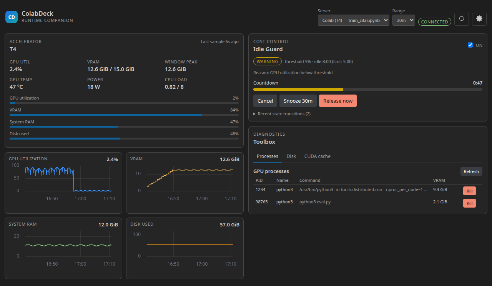

# ColabDeck

A companion panel for the official Google Colab VS Code extension (`google.colab`). Watch GPU curves while a training cell runs, get a countdown when the GPU sits idle so you can release the runtime, and use a small, mostly read-only toolbox.

[](LICENSE)

[Quick start](#quick-start) · [Docs](#docs) · [Configuration](docs/configuration.md) · [Known limitations](#known-limitations) · [简体中文](README.zh-CN.md)



## What it does

- **Monitoring**: GPU utilization, VRAM (with window peak), system RAM, and disk charts, plus GPU temperature, power draw, and CPU load readouts. A separate process inside the runtime does the sampling, so the dashboard keeps updating while a training cell runs.
- **Idle Guard**: after the GPU stays below 5% for 5 minutes, a 120-second countdown starts. Cancel, snooze, or release. When the countdown ends, the official release dialog opens; you confirm it.
- **Toolbox**: GPU process list, a confirmed Kill, a read-only scan for large files, and CUDA cache cleanup through the notebook kernel.

## Quick start

You need VS Code >= 1.99.3 with the official `google.colab` and `ms-toolsai.jupyter` extensions installed and signed in.

1. Install ColabDeck. See *Install from source* below.
2. Assign a runtime in the official Colab extension.
3. Open the dashboard from the Activity Bar or the status bar, then click **Mount server**. The dashboard opens in the sidebar by default and switches to two columns when you widen it.
4. Charts start updating once the status is `connected`.

Stuck on `Starting`? Click **Refresh**. The error card has **Retry** and **View diagnostics**. When the connection is `error` or `stale`, or a server is selected but `disconnected`, **Restart probe** appears in the header.

<details>
<summary><b>Install from source</b></summary>

Requires Node.js >= 20 and npm >= 10. After cloning the repository:

```bash
npm install
npm run package:vsix
code --install-extension release/colabdeck-<version>.vsix
```

Debugging, tests, and Marketplace publishing are covered in the [development guide](docs/development.md).

</details>

## Docs

The guides are written in Chinese.

| Want to know | Read |
| --- | --- |
| Where the metrics come from, what Colab exposes, time windows, stale detection | [Monitoring](docs/monitoring.md) |
| Idle Guard states, thresholds, release flow | [Idle Guard](docs/idle-guard.md) |
| Process list, Kill, disk scan, CUDA cache | [Toolbox](docs/toolbox.md) |
| Every setting with defaults and ranges | [Configuration](docs/configuration.md) |
| Build, test, directory layout, code map | [Development](docs/development.md) |
| Probe files and webview messages | [protocol.md](docs/protocol.md) |
| Full architecture, transition tables, decision records | [phase-1-architecture.md](docs/phase-1-architecture.md) |
| Real Colab acceptance checklist | [mvp-validation.md](docs/mvp-validation.md) |

## Known limitations

- Releasing the runtime still needs your confirmation in the official dialog; "automatic release" only opens that dialog.
- Only one selected server is monitored at a time.
- The official terminal flashes briefly when sampling starts.
- No compute-unit balance: ColabDeck does not call Google's private quota API or imitate Jupyter and Colab private protocols.
- GPU temperature and power depend on `nvidia-smi`; some GPUs report `[N/A]`, shown as `—`.

## License

GPL-3.0-or-later. See [LICENSE](LICENSE).
