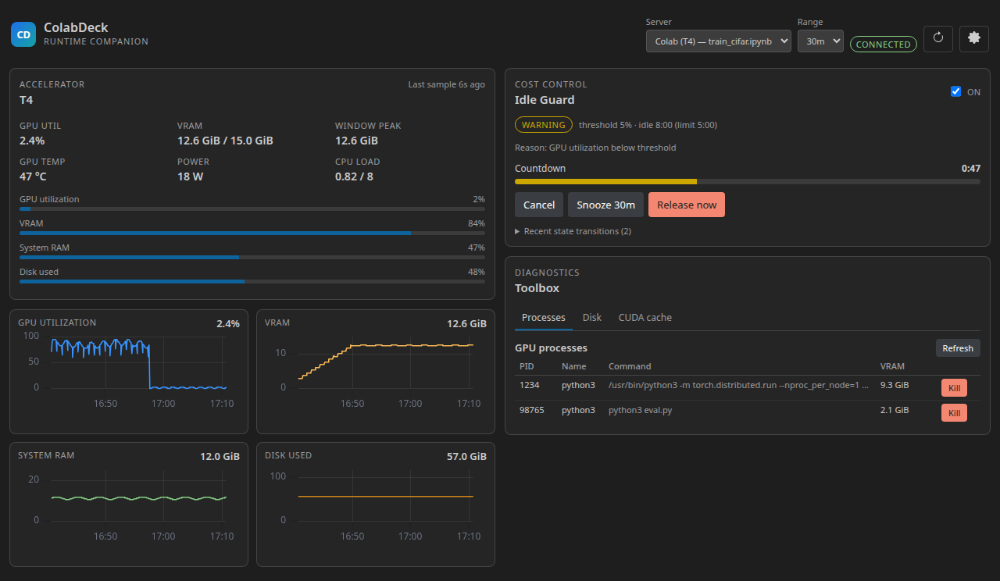

# ColabDeck

官方 Google Colab VS Code 扩展（`google.colab`）的伴生面板。训练时看 GPU 曲线不卡内核，GPU 闲下来倒计时提醒你释放 runtime，再附一组以只读为主的排障工具。

[](https://marketplace.visualstudio.com/items?itemName=NanamiKite.colabdeck) [](LICENSE)

[快速开始](#快速开始) · [文档](#文档) · [配置](docs/configuration.md) · [已知限制](#已知限制) · [English](README.md)



## 它做三件事

- **监控**：GPU 利用率、VRAM（含窗口峰值）、系统 RAM、磁盘四条曲线，加 GPU 温度、功耗、CPU 负载读数。可选 **Notebook**（从当前 Python Colab notebook 启动私有采集器，不用挂载工作区或打开终端）或 **Mounted runtime**（监控已挂载服务器上的独立探针）。
- **Idle Guard（Mounted runtime）**：GPU 连续低于 5% 满 5 分钟后开始 120 秒倒计时，可 Cancel / Snooze / Release now。倒计时结束打开官方释放对话框，由你确认。
- **工具箱（Mounted runtime）**：GPU 进程表、带确认的 Kill、只读磁盘大文件扫描。

## 快速开始

前置：VS Code >= 1.99.3，已安装并登录官方 `google.colab` 和 `ms-toolsai.jupyter`。Notebook 监控还需要受信任的工作区和正在运行的 Python notebook 内核。

1. 从 Marketplace 安装：在扩展面板（`Ctrl+Shift+X`）搜索 `ColabDeck`，或在命令面板执行 `ext install NanamiKite.colabdeck`。
2. 在官方 Colab 扩展中分配 runtime，并打开连接到该 runtime 的 `.ipynb`。先运行一次 cell，确保 Python 内核就绪。
3. 从活动栏或状态栏打开 ColabDeck。默认的 **Notebook** 来源不需要挂载工作区或终端；内核空闲时点击 **Start Monitoring**。
4. 运行训练 cell。内核忙时采集器仍在后台运行；内核再次空闲后点击 **Sync samples** 把新数据带入曲线，结束后点击 **Stop**。

如需原来的挂载服务器流程，切换来源到 **Mounted runtime**，点击 **Mount server** 后再点 **Start Monitoring**。如果探针还没运行，在官方 Colab 扩展里打开该 runtime 的终端，等终端连上后点击 **Retry Monitoring**。挂载和 **Refresh** 都不会自行启动监控。

<details>
<summary><b>从源码安装</b></summary>

开发用。需要 Node.js >= 20、npm >= 10。克隆仓库后：

```bash
npm install
npm run package:vsix
code --install-extension release/colabdeck-<version>.vsix
```

调试运行、测试和上架流程见 [开发文档](docs/development.md)。

</details>

## 文档

| 想知道 | 看这里 |
| --- | --- |
| 指标来源、Notebook 与挂载服务器采集流程、时间窗、stale 判定 | [监控](docs/monitoring.md) |
| Idle Guard 状态、阈值、释放流程 | [Idle Guard](docs/idle-guard.md) |
| 进程表、Kill、磁盘扫描、CUDA 缓存 | [工具箱](docs/toolbox.md) |
| 每个设置项的默认值和取值范围 | [配置](docs/configuration.md) |
| 构建、测试、打包与发布、目录结构、代码地图 | [开发](docs/development.md) |
| 探针文件与 Webview 消息协议 | [protocol.md](docs/protocol.md) |
| 完整架构、转换表与决策记录 | [phase-1-architecture.md](docs/phase-1-architecture.md) |
| 真实 Colab 验收清单 | [mvp-validation.md](docs/mvp-validation.md) |

## 已知限制

- 释放需要在官方对话框里确认；"自动释放"只是把对话框打开。
- Mounted runtime 模式一次只监控一个选中的服务器。
- Notebook 监控要求受信任工作区中的 Python Jupyter 内核。启动和同步会通过该内核提交短辅助请求，并要求内核空闲；训练 cell 运行时采集仍在后台继续，但必须在内核空闲后同步才会更新曲线。
- Notebook 监控不挂载工作区、不打开终端，也不提供 Idle Guard 和工具箱；需要这些功能时切换到 **Mounted runtime**。
- Notebook 采集器保留有上限的历史，长时间不同步会过期；长任务期间请定期同步。切换到其他 notebook 不会自动停止会话；停止前请回到正在监控的 notebook。
- 不显示算力点余额：ColabDeck 不调用 Google 私有配额接口，也不模拟 Jupyter / Colab 私有协议。
- Jupyter 扩展可能不向此发布者开放 Kernel API；此时 Notebook 监控会提示无法执行，挂载服务器监控仍可在无该 API 时工作。
- Jupyter 公共 kernel 查询不会提供可验证的 Colab runtime ID；Notebook 模式使用用户当前选中的 Python 内核，不声称已验证 provider 身份。
- GPU 温度和功耗依赖 `nvidia-smi`，个别机型返回 `[N/A]`，显示为 `—`。

## 许可证

GPL-3.0-or-later，见 [LICENSE](LICENSE)。
